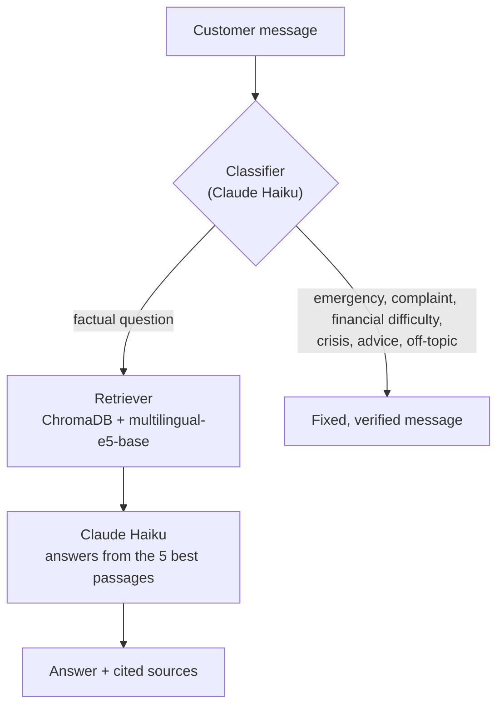

# AI Bank Advisor: a RAG assistant built on official banking documents

An AI assistant that answers customer questions about a French bank's fees, cards and procedures, **using only the bank's official public documents**. It cites its sources, says when it doesn't know, refuses to give personal financial advice, and sends emergencies (stolen card, distress) to verified, human-written instructions.

> ⚠️ **Demonstration project, not affiliated with BNP Paribas.** The answers are based on public documents and are not financial advice.

**Live demo:** https://ai-bank-advisor.streamlit.app/

---

## What the assistant does

- **Answers from three official documents only**: the fee brochure (fees as of 1 January 2026), the general terms of the account agreement (April 2026 edition) and the card contract (April 2026 edition).
- **Cites a source for every fact**: document, version and page. Only the passages actually used are shown.
- **Says "I don't know"** when the documents don't contain the answer, instead of guessing.
- **Knows today's date**: it won't present a discontinued service as available (example: the "Facilidom" service, still listed in the 2026 brochure but removed on 30/04/2026).
- **Refuses personal recommendations** ("which card should I take?") and gives the facts instead.
- **Detects sensitive situations** before any search: emergencies, complaints, financial difficulty, distress, off-topic requests and prompt injections. Each one gets a fixed message written and checked by a human.
- **Answers in French or English**.

## How it works



The index is built once, offline:

```
3 PDFs → loading and cleaning → chunking (one strategy per document type) → embeddings → ChromaDB
```

## The project, step by step

### 1. Choosing the documents
A national bank was chosen so that fees are the same everywhere in France. Only the **versions currently in force** were kept. Three tempting files were deliberately left out: a document listing only the fee *changes* (it would duplicate fees), the Monaco brochure (different customers) and the English translation (every fee would be indexed twice). Every source is recorded with its URL and date in `data/raw/sources.md`.

The card contract was added later, after testing showed that the procedure for a stolen card **wasn't in the corpus at all**: the account agreement refers to a separate "Contrat carte". A realistic test question revealed a gap that no code review would have found.

### 2. Loading the PDFs
The usual LangChain PDF loaders live in `langchain-community`, which was sunset in June 2026, so the project uses its **own small loader** built on `pypdf`. Each page becomes a LangChain `Document` with metadata: file, page, official title, version and document type. Cover pages, a table-of-contents-only page and a blank "NOTES" page are skipped, and layout noise (page numbers, an internal document code) is removed.

### 3. Chunking
Pages are cut into chunks of about 1,000 characters, with **a different strategy per document type**, because a fee list and a legal text don't have the same structure:
- **Fee brochure**: cut between list items, so that a price never gets separated from the service it belongs to.
- **Legal texts** (account agreement, card contract): cut along parts, chapters, numbered sections and sentences, using regular expressions matched to the documents' layout.

Titles left alone by the splitter are merged with the content that follows them, and every chunk starts with a header naming its document and version. Result: **481 chunks**.

### 4. Embeddings and index
Chunks are embedded with **`intfloat/multilingual-e5-base`**, an open-source multilingual model that runs locally (no extra API key, no cost per search). It uses the model's required `query:` / `passage:` prefixes. Vectors, texts and metadata are stored in **ChromaDB** on disk, so the app loads the index in seconds instead of re-embedding everything.

### 5. Generating the answer
The 5 most relevant chunks are numbered and sent to **Claude Haiku** with a system prompt of 8 rules: use only the passages, cite them, admit missing information, compare dates with today's date, answer in the customer's language, copy amounts and phone numbers exactly, answer only the question asked, keep the strength of obligations, and never give personal recommendations.

### 6. Guardrails
Before any search, a classifier (Claude Haiku) puts each message into one of 7 categories and detects its language. Only factual questions reach the RAG pipeline. All the other categories get a **fixed message** from `src/messages.py`, where every fact (blocking phone numbers, complaint steps, response times...) was checked against the source documents and is cited. Critical information is never generated.

Two safety nets cover classifier mistakes: the RAG prompt also forbids personal recommendations (**defense in depth**), and non-urgent fixed messages end with a sentence inviting the customer to rephrase if they were misunderstood.

### 7. The app
A Streamlit chat interface with a custom green theme, example questions, collapsible sources, emergencies highlighted in red, and a clear "demonstration / AI / no personal data" notice.

## Evaluation

Every change was measured on the same tests and recorded, including the failures.

### Retrieval (23 hand-written questions)

| Setup | Hit@5 | MRR |
|-------|-------|-----|
| multilingual-e5-small | 70% | 0.626 |
| **multilingual-e5-base** | **91%** | **0.661** |

*Hit@5 = share of questions with a correct passage in the top 5. One test target was found to be incomplete during the analysis (it missed the card contract's dispute chapter); the correction is documented, and both models were re-scored on the corrected test.*

Debugging the stolen-card question showed how much each fix mattered (rank of the correct passage among all chunks, colloquial wording):

| Change | Rank |
|--------|------|
| Card contract added to the corpus | 27 |
| Layout noise removed, title-only "magnet" chunks merged | 18 |
| Bigger embedding model (e5-base) | 12 |

### Guardrails classifier
- **26/26** on the labeled test set, which places "boundary" messages side by side (a card lost an hour ago vs. lost last month, a question about dispute deadlines vs. fraud happening right now).
- **96%** average over 5 runs on 11 held-out messages (SMS style, slang, mixed messages, indirect distress signals, prompt injection). Emergencies and the crisis case were correct in **every** run.

### Prompt iterations
The generation prompt went through 5 versions, each tested on the same questions. For example, version 2 fixed answers that drifted off topic but introduced a regression (a useful alternative service disappeared), which version 3 fixed.

## Key lessons
- **Test with realistic questions early**: they reveal missing documents, not just bad code.
- **Short chunks with no content become "magnets"** that attract every question on their topic.
- **One chunking strategy doesn't fit every document**: look at how the text is actually extracted.
- **Never judge from one example.** Build test sets, keep some messages held out, beware of data leakage, and average over several runs: LLM outputs vary.
- **Use code for what must be exact** (emergency phone numbers) and the LLM for what must be understood (a panicked message with typos).

## Known limitations
- The standalone price of a card is sometimes not retrieved: on the relevant page, the reduction icons are extracted as noise in the price lines. When this happens, the assistant says it didn't find the price instead of inventing one.
- Several price tables look alike (current and discontinued offers), and a chunk doesn't always say which offer its table belongs to.
- Questions mixing several topics only get part of the answer, since only 5 passages are retrieved.
- "No longer sold" and "no longer exists" are not always distinguished.
- The latest classifier version (which also detects the language) was checked on example messages but not re-scored on the full test sets.

**Next steps:** contextual retrieval (an LLM writes a short context for each chunk), end-to-end answer evaluation with Ragas (faithfulness, answer relevancy), and hybrid keyword + semantic search.

## Tech stack
- **Python 3.13**
- **LangChain**: `langchain-core`, `langchain-anthropic`, `langchain-chroma`, `langchain-text-splitters`
- **Claude Haiku** (Anthropic API) for classification and generation
- **sentence-transformers** with `intfloat/multilingual-e5-base` for embeddings
- **ChromaDB** as the vector store
- **pypdf** for PDF extraction
- **Streamlit** for the interface

## Project structure

```
AI_bank_advisor/
├── app/app.py                  # Streamlit chat interface
├── data/
│   ├── raw/sources.md          # official sources of the documents (URLs, dates)
│   └── eval/                   # retrieval and guardrail test sets
├── notebooks/                  # exploration, one notebook per step, with experiment logs
├── src/
│   ├── loader.py               # PDF loading, cleaning, metadata
│   ├── chunker.py              # chunking strategies per document type
│   ├── embeddings.py           # multilingual E5 model with its prefixes
│   ├── indexer.py              # builds and loads the ChromaDB index
│   ├── rag.py                  # retrieval + prompt + Claude + citations
│   ├── guardrails.py           # message classifier (category + language)
│   ├── messages.py             # fixed, verified messages
│   └── assistant.py            # entry point: guardrails, then RAG
├── vectorstore/                # the ChromaDB index
└── .streamlit/config.toml      # app theme
```

## Run it locally

```bash
git clone https://github.com/mazetrade/AI_bank_advisor.git
cd AI_bank_advisor
python -m venv .venv
.venv\Scripts\activate          # on macOS/Linux: source .venv/bin/activate
pip install -r requirements-dev.txt
```

Create a `.env` file at the root with your Anthropic API key:

```
ANTHROPIC_API_KEY=your-key
```

Then launch the app:

```bash
streamlit run app/app.py
```

The index is included in the repository. To rebuild it, download the three PDFs listed in `data/raw/sources.md` into `data/raw/`, then run `python -m src.indexer`.

---

*Author: Mazen Ismail*